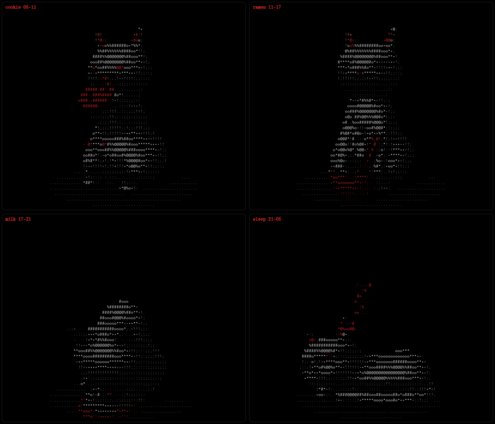

# Cat Screensaver for Omarchy

A 3D cat that lives in your terminal while you're away. It's a ray-marched
signed-distance-field scene rendered to ASCII, white and red only, and what
the cat does depends on the time of day:

| Scene  | Hours | |
|--------|-------|-|
| cookie | 05–11 | munches a cookie |
| ramen  | 11–17 | slurps ramen |
| milk   | 17–21 | laps up milk |
| sleep  | 21–05 | curled up and breathing, with Zs floating up |



Frames are rendered once per terminal size and scene, then cached in
`~/.cache/cat-screensaver/`, so playback is about 1% CPU even on a 2011
MacBook Pro. The first start at a new size renders in the background
(~15–20 s on an old dual-core) and shows a still frame meanwhile.

## Install

```bash
omarchy plugin add https://github.com/juicemannew/omarchy-cat-screensaver.git --enable
~/.config/omarchy/plugins/io.github.juicemannew.cat-screensaver/install.sh
```

`omarchy plugin add` only clones the repo; it never runs code. The screensaver
itself is a terminal program, so `install.sh` sets it up. It asks which parts
you want:

- **3D cat screensaver.** Required. Creates a Python venv with numpy in
  `~/.local/share/cat-screensaver/venv` (uses `uv` if you have it).
- **Flat bash cat fallback.** Used when Python or numpy isn't there.
  Without it, Omarchy's own screensaver is the fallback.
- **On AC: no idle lock.** A user service sets `idle.lock` to 0 while the
  charger is connected, so the cat stays up, with a charge bar under it.
  On battery, `idle.lock` goes back to `BATTERY_LOCK`.
- **On AC: never blank the display.**
- **Cursor watchdog.** Restores the mouse cursor if a screensaver window
  gets killed hard.
- **ALL for catbookmeow PRO 2011.** All of the above.

Non-interactive: `install.sh --all`, or
`install.sh --components core,fallback,ac,noblank,cursor`.

### How it hooks in

Omarchy's idle service runs `omarchy-launch-screensaver`. The installer links
this plugin's `omarchy-screensaver`, `omarchy-launch-screensaver` (and
optionally `omarchy-brightness-display`) into
`~/.local/share/cat-screensaver/bin`. It puts that directory first in
Hyprland's PATH through a marked block at the end of
`~/.config/hypr/hyprland.lua`, then reloads Hyprland and restarts the shell.
`omarchy plugin update` keeps working because the links point into the
plugin checkout.

## Use

```bash
cat-screensaver demo           # every scene in turn, 15 s each (any key skips ahead)
cat-screensaver preview ramen  # start it now with a given scene
cat-screensaver scene sleep    # always show this scene (auto = by time of day)
cat-screensaver menu           # scene picker in the Omarchy shell
```

Settings are in `~/.config/omarchy/cat-screensaver.conf`:

```bash
SCENE=auto          # auto, cookie, ramen, milk, sleep
FONT_SIZE=10        # screensaver terminal font: smaller = more detailed cat
BATTERY_LOCK=300    # idle lock on battery, seconds (AC watch)
FALLBACK=simple     # simple (bash cat) or omarchy
CURSOR_WATCHDOG=1
```

Works in kitty, Alacritty, Ghostty and foot (foot ignores `FONT_SIZE`).

## Uninstall

```bash
~/.config/omarchy/plugins/io.github.juicemannew.cat-screensaver/uninstall.sh   # --purge also removes venv, cache, settings
omarchy plugin remove io.github.juicemannew.cat-screensaver
```

## License

MIT
